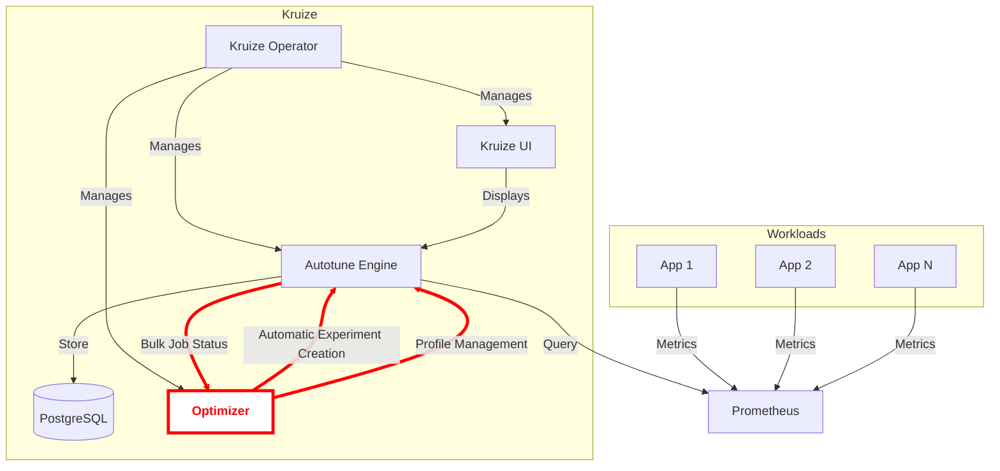

# Design Documentation

This document describes the architecture, design principles, and key components of the Kruize Optimizer.

## Table of Contents

- [Overview](#overview)
- [Architecture](#architecture)
- [Core Workflows](#core-workflows)
- [Design Principles](#design-principles)
- [Technology Stack](#technology-stack)

## Overview

Kruize Optimizer is a cloud-native optimization service designed to provide support for Kruize (https://github.com/kruize/autotune) to automatically create experiments and manage Kruize profiles.

### Key Features

- **Automatic Experiment Creation**: Automatically create experiments in Kruize based on user-defined labels.
- **Profile Management Support**: Manages and installs missing profiles in Kruize.
- **Config-Driven Scheduling**: Per-config bulk job scheduling via BulkConfig objects fetched from Kruize, with runtime updates through webhooks.
- **Webhook Integration**: Event-driven architecture for real-time updates

## Architecture

### High-Level Architecture



## Core Workflows

### 1. Optimizer Workflow

On startup, the Optimizer connects to Kruize and ensures all required profiles (metadata, metric, layer, bulk config) are installed. It then fetches all enabled BulkConfig objects from Kruize and schedules a recurring timer for each based on its configured interval.

When a timer fires, the Optimizer converts the BulkConfig into a bulk job request — applying its namespace, label, and experiment type filters — and submits it to Kruize. Kruize processes the experiments, generates recommendations, and sends the results back to the Optimizer via a webhook callback. The Optimizer tracks job and experiment counts for observability.

A periodic state refresh ensures newly added profiles are installed and the cached Kruize state (datasources, profiles, layers) stays current.

```
1. User installs Kruize and Optimizer
   ↓
2. Optimizer installs missing profiles on startup (and periodically)
   ↓
3. User labels their workloads
   ↓
4. Per-config timer fires: converts BulkConfig to bulk job request
   (applies filters: namespaces, labels, experiment types, datasource)
   ↓
5. Bulk job submitted to Kruize
   ↓
6. Kruize generates recommendations for created experiments
   ↓
7. Kruize sends webhook callback to Optimizer
   ↓
8. Optimizer updates job/experiment counters
   ↓
9. Users view recommendations on Kruize UI
```

### 2. Bulk Config Update

BulkConfig objects can be updated at runtime without restarting the Optimizer. When Kruize sends an update to the `POST /webhook/config/bulk` endpoint, the Optimizer evaluates the change and adjusts accordingly: creating or rescheduling a timer for enabled configs, canceling timers for disabled configs, or triggering an immediate job execution when a schedule is shortened.

```
1. Kruize sends config update to POST /webhook/config/bulk
   ↓
2. Optimizer evaluates the change:
   → Config enabled with new schedule: timer created or rescheduled
   → Config disabled: existing timer canceled
   → Schedule shortened: next job executes immediately
```

## Design Principles

### 1. Separation of Concerns

Each layer has a distinct responsibility:
- **Resources**: HTTP handling and validation
- **Services**: Business logic and orchestration
- **Models**: Data representation
- **Clients**: External communication

### 2. Profile-Based Configuration

Flexible configuration through JSON profiles allows:
- Easy customization without code changes
- Version-controlled configurations
- Environment-specific settings
- Extensibility for new metrics and layers

### 3. Stateless Design

The service is designed to be stateless where possible:
- Enables horizontal scaling
- Simplifies deployment
- Improves reliability


## Technology Stack

### Core Framework

- **Quarkus**: Cloud-native Java framework
  - Fast startup time
  - Low memory footprint
  - Native compilation support
  - Reactive and imperative programming models

### Build Tools

- **Maven**: Project management and build
- **Docker**: Containerization
- **Kustomize**: Kubernetes configuration management

## Future Enhancements Planned 

- Improve Logging and Tracing
- Add support for custom Prometheus metrics
- Add support for multiple custom pre-configured profiles for dev/prod clusters

---

**Previous**: [API Reference](optimizerAPI.md) | **Next**: [Build Guide](build.md) | [Back to docs](README.md)

**Last Updated**: 2026-11-04